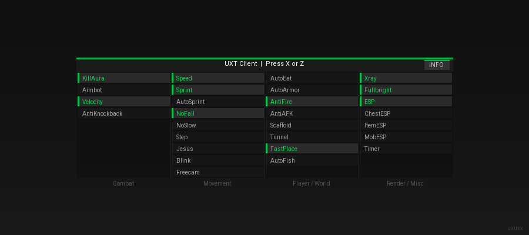

# UXT Client

Advanced Minecraft 1.16.5 Fabric cheat client with 31 powerful modules.



## Features

### Combat
- **KillAura** - Automatically attacks nearby entities with configurable range
- **Aimbot** - Locks onto targets with FOV and range settings
- **Velocity** - Reduces knockback taken from attacks
- **AntiKnockback** - Prevents knockback with adjustable strength

### Movement
- **Speed** - Increases movement speed with configurable multiplier
- **Sprint** - Automatically sprints when moving forward
- **AutoSprint** - Always keeps sprint enabled
- **NoFall** - Prevents fall damage
- **NoSlow** - Removes slowdown when using items
- **Step** - Allows stepping up higher blocks
- **Jesus** - Walk on water surfaces
- **Blink** - Freezes server position while moving
- **Freecam** - Fly freely through blocks

### Player
- **AutoEat** - Automatically eats when hungry
- **AutoArmor** - Equips best armor automatically
- **AntiFire** - Extinguishes fire instantly
- **AntiAFK** - Prevents AFK kicks with random movements

### World
- **Scaffold** - Automatically places blocks under you
- **Tunnel** - Mines a tunnel in the direction you're facing
- **FastPlace** - Removes block placement delay
- **AutoFish** - Automatically fishes for you

### Render
- **Xray** - See ores and valuable blocks through walls
- **Fullbright** - Maximum brightness in all areas
- **ESP** - See entities through walls
- **ChestESP** - Highlights chests in render distance
- **ItemESP** - Highlights dropped items with range setting
- **MobESP** - Highlights hostile mobs with configurable range

### Misc
- **Timer** - Speed up or slow down game time

## Controls

- **X** or **Z** - Open/close GUI (works with RU/EN keyboard layouts)
- **Single Click** - Toggle module on/off
- **Double Click** - Open module settings (if available)
- **INFO Button** - View client information

## Installation

### Requirements
- Minecraft 1.16.5 Java Edition
- Fabric Loader
- Fabric API

### Steps

1. Install Fabric Loader for Minecraft 1.16.5
2. Download the latest `uxt-1.0.0.jar` from [Releases](https://github.com/uxuxs82/uxt-client/releases)
3. Place the JAR file in your `.minecraft/mods` folder
4. Make sure Fabric API is also in the mods folder
5. Launch Minecraft with Fabric profile

## Building from Source

```bash
git clone https://github.com/uxuxs82/uxt-client.git
cd uxt-client
./gradlew build
```

The compiled JAR will be in `build/libs/`

## Module Settings

Many modules include configurable settings accessible via double-click:

- **KillAura**: Range (3.0 - 6.0)
- **Aimbot**: Range (20-100), FOV (30-180)
- **Speed**: Speed multiplier (1.0 - 5.0)
- **Step**: Height (0.5 - 2.0)
- **AutoEat**: Hunger threshold (5-19)
- **Timer**: Game speed (0.5 - 5.0)
- **ItemESP**: Range (16-64)
- **MobESP**: Range (32-128)

## Compatibility

- **Version**: Minecraft 1.16.5 Java Edition
- **Mod Loader**: Fabric
- **Server Compatibility**: Client-side only (some modules detectable by anti-cheat)

## Disclaimer

This client is for educational purposes. Use responsibly and only on servers where cheats are allowed. I am not responsible for any bans or consequences from using this mod.

## Credits

**Author**: uxuxx

Built with Fabric and love for the Minecraft community.

## License

See [LICENSE](LICENSE) file for details.
